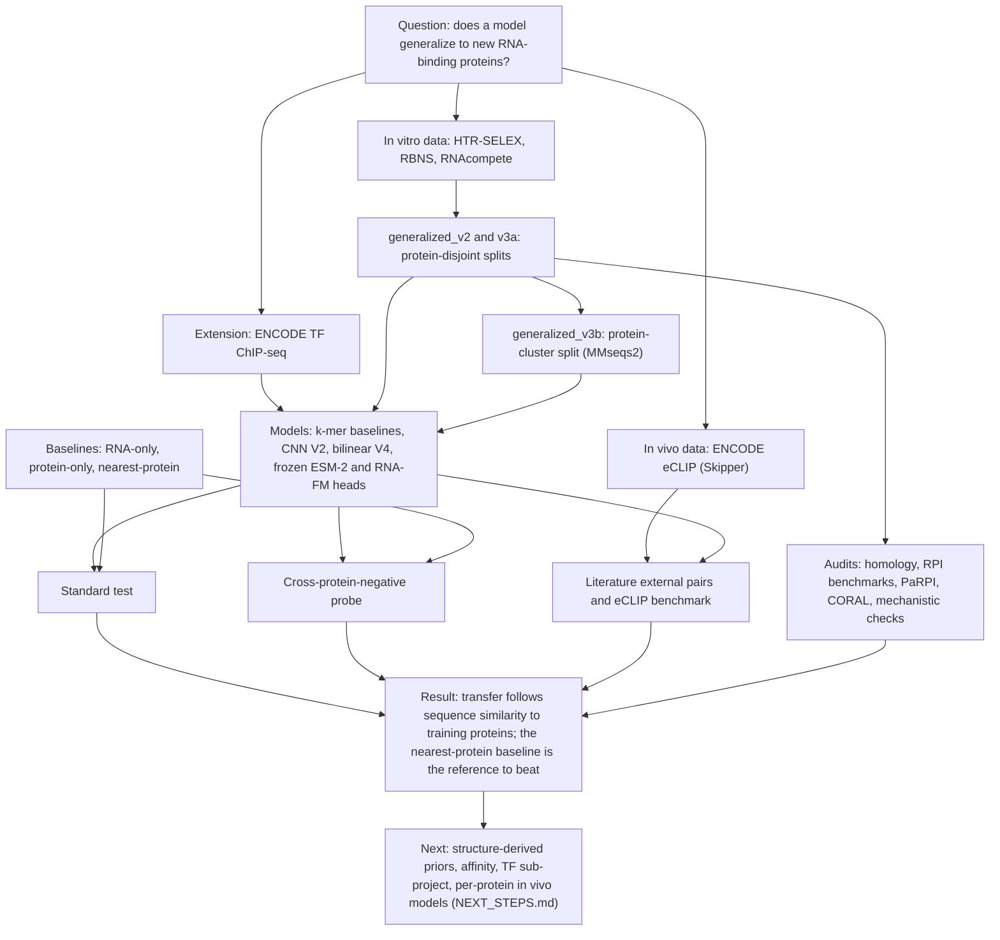

# Protein-RNA Binding Prediction

Machine learning pipeline that predicts whether an RNA-binding protein (RBP) binds a given RNA sequence. Training data come from in vitro assays (HTR-SELEX, RBNS, RNAcompete). Evaluation uses protein-disjoint splits, a protein-cluster split (v3b), a cross-protein-negative probe, literature external pairs, in vivo eCLIP benchmarks and cross-protocol transfer for matched RBPs.

```
Input:  protein amino acid sequence + RNA nucleotide sequence
Output: binding probability in [0, 1]
```

Run history with hypotheses, decision rules and results: [`EXPERIMENT_LOG.md`](EXPERIMENT_LOG.md). Script map: [`SCRIPTS.md`](SCRIPTS.md). VM commands: [`docs/VM_RUNBOOK.md`](docs/VM_RUNBOOK.md). Plan and open checks: [`NEXT_STEPS.md`](NEXT_STEPS.md). File inventory: [`INVENTORY.md`](INVENTORY.md). Metrics up to Phase 3B: [`results/phase3b_summary.json`](results/phase3b_summary.json).

---

## Project logic

The question is whether a model trained on RNA-protein binding data predicts binding for proteins it has not seen. The work follows one chain: build training sets from several assays, test generalization with progressively stricter splits, and compare every model with simple baselines that use one molecule or the nearest training protein.



Where each box is implemented: [`SCRIPTS.md`](SCRIPTS.md) (script map and pipeline diagrams). Where each result is recorded: [`EXPERIMENT_LOG.md`](EXPERIMENT_LOG.md).

---

## Current status

AUROC is the area under the ROC curve on the test proteins of the named split. "Probe" is the cross-protein-negative probe (the same RNA paired with another protein of the same assay, so RNA composition carries no information and RNA-only models score 0.500).

| Phase | Status | Result |
|---|---|---|
| 1. Per-dataset validation | Complete | All 3 datasets pass on validation (val AUROC 0.758-0.825, threshold 0.70) with k-mer LR/RF/XGBoost on protein-disjoint splits |
| 2. Generalized V1-V3c on `generalized_v2` | Complete | V2 CNN test AUROC 0.690, AUPRC 0.580 (24 test proteins). V3, V3b, V3c with frozen ESM-2: 0.634, 0.666, 0.685 |
| 3A. V2 on `generalized_v3a` | Complete | Test AUROC 0.813, AUPRC 0.713 (55 test proteins, 494 proteins in total, 2,658,999 pairs, 1 seed) |
| 3B. V4 bilinear on v3a | Complete | Test AUROC 0.829 +- 0.009, AUPRC 0.732 +- 0.011 (3 seeds), +0.016 over V2 on the same test set |
| 3B. Literature external pairs | Complete | Curated (159 pairs) AUROC 0.763 (V2) and 0.737 (V4). Expanded (540 pairs) 0.688 and 0.666 |
| Cross-protocol in vitro | Complete | 84 matched RBPs, k=4 LR: within-protocol mean AUROC 0.974, cross-protocol mean 0.791 (196 and 284 evaluations) |
| Domain-aware V2 | Closed (null) | `scripts/38`, sanitized v3a with known domains: domain-label shuffle 0.855, baseline 0.847, domain-conditioned 0.842 |
| Homology audit and `generalized_v3b` (55-58, 62) | Complete | Test proteins with a training protein at >= 50% identity: 62% (v3a) and 3% (v3b) |
| Nearest-protein baseline and frozen ESM-2 / RNA-FM heads on v3b (59, 65-67, 69-71) | Complete | Probe AUROC: nearest-protein baseline 0.627 [0.57, 0.68], best frozen head 0.559 +- 0.010 (3 seeds), V4 0.559 and V2 0.527 (seed 42) |
| RPI benchmark audit, PaRPI, CORAL (60, 63, 64, 78, 79) | Complete (10 of 25 CORAL folds) | RPI369: protein-only AUROC 0.964 against 0.974 with both molecules (random 5-fold). CORAL component-wise folds: gradient boosting on composition features 0.654 (30/50) and 0.710 (60/80) |
| Skipper eCLIP benchmark (41-54) | Closed (no transfer from in vitro) | Genomic-negative splits: RNA-only k-mer LR 0.808. `cross_protein_neg`: no tested model above 0.53 GC-matched within protein |
| Mechanistic checks (61, 68, 75) | Complete | RBFOX2 top 5-mer GCAUG recovered by V2 (Spearman 0.48 over 5-mer profile, protein seen in training) |
| ENCODE TF ChIP-seq rows as extra training data (76) | Complete | 248 TFs, 857,839 rows. Probe AUROC with cross-protein negatives 0.535 +- 0.021 with and 0.559 +- 0.010 without TF rows |
| ENCODE protein map (82, 83) | Complete (exploratory) | 1,051 TF and RBP proteins in ESM-2 space: RBP against TF separation AUROC 0.973 at layer 21 (layer 33: 0.882, UniProt RNA-binding keyword: 0.853). Similarity of embeddings explains almost none of the similarity of 5-mer binding profiles (Spearman at most 0.10) or of genomic peak overlap (size-adjusted +0.007 to +0.031 over 107,000 TF and RBP pairs). See [`docs/ENCODE_MAP.md`](docs/ENCODE_MAP.md) |
| ESM-2 layers against RNAcompete profile similarity (80) | Result for 175 proteins | Spearman 0.07-0.16 between embedding cosine and 7-mer Z-score correlation. Follow-ups (domain pooling, RNA-FM layers, frozen heads with layers 0/22/26/32) not run |

Notes on sources. The V4 numbers (0.829 +- 0.009 over 3 seeds, external 0.737 and 0.666) are taken from `results/phase3b_summary.json`. The per-run files are in `results/multiseed/v4_concat_bi_v3a/` (summary of the three seeds and one result file per seed), `results/generalized/v4_phase3a/` (seed 42 training result) and `results/external/v4_phase3a_{curated,expanded}/` (scored literature pairs). Model weights are on the GPU VM only. The V1 result file (`results/generalized/v1_mlp_results.json`) is dated 2026-04-27, before the sampler fix of `scripts/05`, and its rerun is pending. V2, V3, V3b and V3c were rerun on 2026-05-13 after the double class-weighting fix ([`EXPERIMENT_LOG.md`](EXPERIMENT_LOG.md), section Known Bugs).

Documents: [`docs/METHODS.md`](docs/METHODS.md) (splits, metrics, models, result tables), [`docs/DATA.md`](docs/DATA.md) (provenance, leakage, dataset versions), [`docs/DATA_SOURCES_AND_DOWNLOADS.md`](docs/DATA_SOURCES_AND_DOWNLOADS.md), [`docs/DATA_QUALITY_DATASETS.md`](docs/DATA_QUALITY_DATASETS.md), [`docs/DATA_CLIP_PRIM_INVENTORY.md`](docs/DATA_CLIP_PRIM_INVENTORY.md), [`docs/STRATEGY.md`](docs/STRATEGY.md). Completed plans and legacy dashboards: [`docs/archive/`](docs/archive/).

---

## generalized_v3b and the cluster split

`generalized_v3a` splits the 494 proteins by protein name (train 393, val 49, test 55). Homology to training is measured in the audit of `scripts/55` (all-vs-all MMseqs2): 62% of the 55 v3a test proteins have a training protein at >= 50% identity, and probe AUROC rises with that identity (V4: 0.525 without hit, 0.699 at 30-50%, 0.884 at 70-90%, 0.874 at >= 90%). `scripts/58` re-splits the same 2,658,999 pairs by protein cluster (single linkage: 40% identity at 50% coverage, or 70% identity at 10% coverage): 160 clusters, train 375, val 55, test 64 proteins, and 3% of the test proteins have a training protein at >= 50% identity.

| Question | Result (subset, seeds) | Log entry |
|---|---|---|
| Do V2 and V4 separate the probe on v3a? | V4 0.754 +- 0.001, V2 0.686 +- 0.015 (v3a probe, 3 seeds). With no detectable homolog in training both are at 0.48-0.53 | 2026-10-28, 2026-10-29 |
| Nearest-protein baseline (RNA-only k-mer LR of the most similar training protein, MMseqs2 identity) | v3b probe 0.627 [0.57, 0.68], v3b standard test 0.676 [0.61, 0.74]. On the v3a probe 0.724-0.746 | "Nearest-protein baseline" |
| V2 and V4 trained on v3b (seed 42) | Probe 0.527 (V2) and 0.559 (V4). Standard test 0.677 and 0.676 | "v3b (cluster split) first neural results" |
| Frozen ESM-2 650M layer 33 + RNA-FM heads (3 seeds, v3b) | Bilinear head: probe 0.531 +- 0.027 (ordinary labels), 0.559 +- 0.010 (cross-protein negatives). RNA-only head: standard test 0.651, probe 0.500 | "three seeds of the frozen-embedding heads" |
| Stacking nearest-protein score and frozen head (seed 42) | Probe 0.630 against 0.627 for the baseline alone | "held-out stacking" |
| Seen proteins with the same head | Probe 0.827-0.828 on held-out RNAs of training proteins | "diagnostics of the frozen head" |
| TF ChIP-seq rows added to training | 0.547 +- 0.016 against 0.531 +- 0.027 (ordinary labels), 0.535 +- 0.021 against 0.559 +- 0.010 (cross-protein negatives) | "TF ChIP-seq rows" |
| Reverse transfer, eCLIP-trained k-mer LR scored on the same protein in vitro (50 proteins) | Mean AUROC 0.670 [0.611, 0.723], RNA prior 0.579, own-data ceiling 0.947 | "Reverse transfer" |
| ESM-2 layers against RNAcompete profile similarity | Spearman 0.07-0.16 over 175 proteins, best layers 22-32, no layer separated from layer 0 by the protein bootstrap | [`reports/esm_layer_similarity.html`](reports/esm_layer_similarity.html) |

Reports: [`reports/results.html`](reports/results.html) (state of 2026-10-30, before the TF, CORAL and layer sections) and [`reports/esm_layer_similarity.html`](reports/esm_layer_similarity.html). Embeddings and checkpoints are on the GPU VM and are not in git.

---

## Phase tables

Phase 1 (k-mer LR/RF/XGBoost, protein-disjoint splits, 75/11/14% of proteins):

| Dataset | RBPs | Examples | Best val AUROC | Test AUROC |
|---|---|---|---|---|
| HTR-SELEX PRJEB25907 (Ray et al. 2019) | 93 | 279,000 | 0.825 (XGB) | 0.796 (13 proteins) |
| RBNS (Lambert et al. 2020) | 96 | 284,642 | 0.758 (RF) | 0.632 (13 proteins) |
| HTR-SELEX PRJEB47428 (Laverty et al. 2022) | 23 | 69,000 | 0.817 (LR) | 0.628 (4 proteins) |

Combined pool: 632,642 examples and 168 proteins. `generalized_v2` adds 26,362 eCLIP training rows (659,004 rows, 169 proteins in the log).

Phase 2 (`generalized_v2`, retrained 2026-05-13 after the double class-weighting fix, except V1, see notes above):

| Model | Encoding | Val AUROC | Test AUROC | Test AUPRC | Per-protein median |
|---|---|---|---|---|---|
| V1 MLP | RNA 4-mer + protein 3-mer | 0.716 | 0.674 | 0.544 | 0.689 |
| **V2 CNN** | One-hot sequences | 0.746 | 0.690 | 0.580 | 0.714 |
| V3 | Frozen ESM-2 mean-pool + RNA CNN | 0.715 | 0.634 | 0.547 | 0.633 |
| V3b | One-hot CNN + frozen ESM-2 concatenation | 0.770 | 0.666 | 0.568 | 0.676 |
| V3c | Per-residue ESM-2 + Conv1D | 0.745 | 0.685 | 0.595 | 0.711 |

Phase 3A and 3B (`generalized_v3a`, protein-name split, `prot_max=700`):

| Model | Val AUROC | Test AUROC | Test AUPRC | Per-protein median AUROC |
|---|---|---|---|---|
| V2 CNN (seed 42) | 0.818 | 0.813 | 0.713 | 0.817 |
| V4 concat_bi + source embedding (seed 42) | 0.852 | 0.829 | 0.735 | 0.851 |
| V4 concat_bi (seeds 42, 0, 1) | not in summary | 0.829 +- 0.009 | 0.732 +- 0.011 | 0.854 +- 0.004 |

External literature pairs (V2 and V4 trained on v3a, sliding-window maximum for RNAs above 60 nt): curated 159 pairs AUROC 0.763 and 0.737, AUPRC 0.915 and 0.890 (positive rate 0.717). Expanded 540 pairs AUROC 0.688 and 0.666, AUPRC 0.488 and 0.341 (positive rate 0.211). The external set differs from the v3a test set in RNA length, labels and negative definition, see `docs/DATA.md` section 2.2.

Cross-protocol in vitro (`configs/cross_protocol_invitro.yaml`, results in `results/cross_protocol_invitro/`): within-protocol median AUROC HTR-SELEX 0.950, RBNS 0.993, RNAcompete Eukarya 0.992, RNAcompete RBPZoo 0.985. Cross-protocol mean 0.791, 24 of 284 evaluations below 0.55. Strongest pair RNAcompete RBPZoo to RBNS (median 0.961, no RNA overlap), weakest RBNS to HTR-SELEX (0.703). The earlier run with eCLIP in the roster is in `results/cross_protocol/` (within mean 0.963, transfer mean 0.779, 204 and 322 evaluations). More tables (Skipper eCLIP, per-assay RNA-only models, RNAcompete zero-shot of the Phase 2 V2 checkpoint): [`docs/METHODS.md`](docs/METHODS.md) section 9.

---

## Quick start

Data are not in git. Dataset versions and paths: [`docs/DATA.md`](docs/DATA.md) section 6 and [`docs/DATA_SOURCES_AND_DOWNLOADS.md`](docs/DATA_SOURCES_AND_DOWNLOADS.md).

```bash
pip install -r requirements.txt

# Phase 1: validate one dataset
python scripts/02_train_validation_model.py --config configs/rbns_validation.yaml
python scripts/03_evaluate_validation.py --config configs/rbns_validation.yaml --model xgboost

# Phase 2: V2 on generalized_v2
python scripts/04_build_generalized_dataset.py
python scripts/06_train_generalized_v2.py --data_dir data/generalized_v2 --epochs 50

# Phase 3A: build generalized_v3a and train V2
python scripts/22a_prepare_rnacompete_training.py
python scripts/22_build_phase3a_dataset.py --selex_dir data/generalized_v2 \
    --rnacompete data/benchmarks/rnacompete/rnacompete_training_phase3a.tsv \
    --homology_tsv results/homology/train_vs_rnacompete.tsv --out_dir data/generalized_v3a
python scripts/06_train_generalized_v2.py --data_dir data/generalized_v3a --prot_max 700 --epochs 60

# Phase 3B: V4 with 3 seeds, literature external evaluation
python scripts/18_run_multiseed.py --script scripts/21_train_generalized_v4_interaction.py \
    --n_seeds 3 --output_dir results/multiseed/v4_concat_bi_v3a \
    --extra_args "--data_dir data/generalized_v3a --interaction concat_bi --use_source_emb --prot_max 700 --batch_size 512"
python scripts/31_build_external_benchmark.py --xlsx data/external/dataset_without_affinities.xlsx \
    --train_tsv data/generalized_v3a/train.tsv
python scripts/21b_evaluate_external_v4.py --checkpoint models/saved/generalized_v4_phase3a/best_model.pt \
    --benchmark_tsv data/external/external_benchmark_curated.tsv --prot_max 700

# Cross-protocol in vitro (needs the upstream clean TSVs, see DATA_SOURCES_AND_DOWNLOADS.md)
python scripts/33_build_cross_protocol_roster.py --config configs/cross_protocol_invitro.yaml
python scripts/34_cross_protocol_classifiers.py --config configs/cross_protocol_invitro.yaml

# v3b split (cluster map is written once, `build` reads it) and figures from the JSON summaries
python scripts/58_build_v3b_cluster_split.py build
python scripts/32_visualize_phase3a_results.py
```

Historical, valid for the Phase 2 V2 checkpoint only: `scripts/archive/17_prepare_rnacompete_benchmark.py` and `scripts/archive/20_evaluate_benchmark.py` (RNAcompete `rnacompete_all` zero-shot, median per-protein AUROC 0.549 on 715 proteins not in `generalized_v2`). The Eukarya and RBPZoo panels are part of `generalized_v3a` training, so the same evaluation on v3a or V4 checkpoints is not zero-shot.

Scripts 41-54 (Skipper eCLIP and probe) and the VM runners (`scripts/run_*.sh`) are described in [`SCRIPTS.md`](SCRIPTS.md) and [`docs/VM_RUNBOOK.md`](docs/VM_RUNBOOK.md). `data/generalized_v3a/` is the output of `scripts/22`. `data/sanitized/generalized_v3a/` is its copy with cleaned protein sequences (`scripts/40`) read by scripts 38, 41, 51 and 53, see `docs/DATA.md` section 6.

---

## Repository layout

```
protein_rna_ml/
  configs/        YAML for validation, cross-protocol and benchmark runs
  scripts/        numbered scripts 01-81, run_*.sh runners, report builders (see SCRIPTS.md)
  scripts/archive/ superseded or one-off scripts
  src/            data loaders, splits, negative sampling, models (V2 CNN, V4 interaction)
  results/        metrics (JSON, TSV), logs, score tables
  figures/        figures of Phases 1-3 and cross-protocol
  reports/        results.html, esm_layer_similarity.html
  docs/           METHODS, DATA*, STRATEGY, VM_RUNBOOK, archive/
  README.md, EXPERIMENT_LOG.md, NEXT_STEPS.md, INVENTORY.md, SCRIPTS.md
```

The upstream data-processing repositories `htr_selex_analysis`, `htr_selex_prjeb47428`, `rbns_analysis` and `rnacompete_analysis` are separate git repositories with their own `.git`, ignored by this repository. Configs address them as `../<name>/` (next to this folder). In the present working copy they are inside the folder, so the `../` paths resolve after moving them one level up. They are needed only to rebuild the data from scratch. External programs: MMseqs2 and HMMER (Pfam-A) for 11 scripts.

---

## Design decisions

- Protein-disjoint splits: no protein name appears in more than one split (`docs/METHODS.md` section 3). Homology between splits is controlled in v3b only.
- Primary metric AUPRC under a class ratio of about 1:2, AUROC reported for comparability.
- CNN with global max pooling: independent of RNA length (RBNS 20 nt, HTR-SELEX 40 nt).
- Frozen ESM-2 representations: below one-hot V2 on `generalized_v2` (V3, V3b, V3c), and 0.531-0.559 probe AUROC on v3b against 0.627 for the nearest-protein baseline.
- Claims about new proteins use the v3b split and the cross-protein-negative probe. The v3a test set contains proteins with close training homologs.
- RNAcompete in v3a training: Eukarya and RBPZoo full panels and ucRBP 23, so full-panel `rnacompete_all` evaluation of v3a or V4 checkpoints is not zero-shot.
- Cross-protocol matching: representative native name per protocol, exact equality, constructs are not pooled (`scripts/33-34`).

---

## References

- Ray et al. (2019). *Genome Research*. HTR-SELEX PRJEB25907
- Lambert et al. (2020). *Nature*. RBNS
- Laverty et al. (2022). *Nucleic Acids Research*. HTR-SELEX PRJEB47428
- Sasse et al. (2025). *Nature Biotechnology*. RBPZoo / EuPRI RNAcompete
- Ray et al. (2013). *Nature*. RNAcompete Eukarya panel
- Boyle et al. (2023). *Cell Genomics*. Skipper eCLIP
- Liu et al. (2025). *Communications Biology*. ZHMolGraph (reported AUROC 0.798 on its NPInter5 hard split, a literature-interaction task that differs from in vitro binding assays)
- Lin et al. (2023). *Science*. ESM-2
