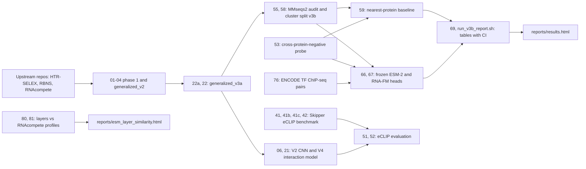
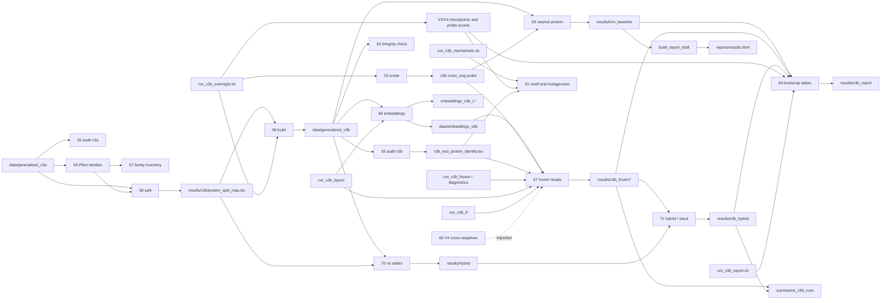

# Script map

Map of `scripts/` and `scripts/archive/` as of 2026-11-26. Every script was read and compiled (`python3 -m py_compile`). Status values: core (used by the current results), historical (documented in the log, kept for reproducibility of earlier results) and archived (moved to `scripts/archive/`, see the reason in the row). Scripts that were moved to `scripts/archive/` take the project root from `parents[2]`.

Paths `../<name>/` refer to the four upstream repositories (see `docs/DATA_SOURCES_AND_DOWNLOADS.md`). Commands are run from the project root. Commands that need the GPU VM are listed in `docs/VM_RUNBOOK.md`.

## Pipeline overview

## Phase 1 and 2: validation and first generalized models

| script | stage | purpose | inputs | outputs | called by / next script | status | run example |
|---|---|---|---|---|---|---|---|
| scripts/01_prepare_dataset.py | Phase 1 | dedupe, protein-aware split, 4-mer RNA + 3-mer protein encoding | `--config` (raw_path under `../<upstream repo>/results/`, the `../` paths do not resolve from here) | data/splits/<ds>/*.tsv, data/processed/<ds>/*_kmer.npz, results/<ds>/metrics/eda_summary.json | next: 02 | core | `python scripts/01_prepare_dataset.py --config configs/htr_selex_validation.yaml` |
| scripts/02_train_validation_model.py | Phase 1 | LR, RF, XGBoost on k-mer features, val metrics, PASS/WARN/FAIL | `--config`, npz from 01 | models/saved/<ds>_validation/*.pkl, results/<ds>/metrics/validation_results.json | after 01, next: 03 | core | `python scripts/02_train_validation_model.py --config configs/rbns_validation.yaml` |
| scripts/03_evaluate_validation.py | Phase 1 | test metrics, per-protein AUROC, plots | `--config --model`, pkl from 02, npz and test.tsv from 01 | results/<ds>/metrics/test_evaluation.json, results/<ds>/plots/*.png | after 02 | core | `python scripts/03_evaluate_validation.py --config configs/rbns_validation.yaml --model xgboost` |
| scripts/04_build_generalized_dataset.py | Phase 2 | merge three Phase 1 datasets, global protein split, k-mer + metadata features, scaler | three `../` paths in `DATASETS` | data/generalized/{train,val,test,full_dataset}.tsv, *_kmer.npz, scaler.pkl, stats.json | next: 05, 06, 07 | historical (builds legacy data/generalized) | `python scripts/04_build_generalized_dataset.py` |
| scripts/05_train_generalized_v1.py | Phase 2 V1 | MLP on k-mer features (sampler removed, pos_weight only) | data/generalized/*_kmer.npz, test.tsv | results/generalized/v1_mlp_results.json, v1_mlp_per_protein.tsv, models/saved/generalized_v1/best_model.pt | after 04, read by 15, 19 | historical (stored V1 result predates the fix) | `python scripts/05_train_generalized_v1.py --epochs 60` |
| scripts/06_train_generalized_v2.py | Phase 2 V2, Phase 3A | dual-branch CNN on one-hot sequences, seed, dry run, `--init_checkpoint` | `--data_dir` TSVs (default data/generalized, README uses generalized_v2 or v3a with `--prot_max 700`) | results/generalized/v2_cnn_results.json, models/saved/generalized_v2/best_model.pt | multiseed and fine-tune runners, read by 15, 19 | core | `python scripts/06_train_generalized_v2.py --data_dir data/generalized_v2 --seed 42` |
| scripts/06_eval_generalized_v2_test.py | Phase 2-3A | evaluate a V2 checkpoint on a test split | `--checkpoint`, `--data_dir` (default data/generalized_v3a) | results/generalized/v3a_scale/v2_cnn_results.json | after interrupted 06 | core | `python scripts/06_eval_generalized_v2_test.py --data_dir data/generalized_v3a --prot_max 700 --no_cuda` |
| scripts/07_extract_esm2_embeddings.py | Phase 2 V3 | mean-pooled ESM-2 embedding per protein | data/generalized/{train,val,test}.tsv, HuggingFace model | data/embeddings/esm2_protein_embeddings.npz | next: 08, 09 | historical | `python scripts/07_extract_esm2_embeddings.py` |
| scripts/07b_extract_esm2_residues.py | Phase 2 V3c | per-residue ESM-2 embeddings padded to 300 | same TSVs | data/embeddings/esm2_residue_embeddings.npz | next: 10 | historical | `python scripts/07b_extract_esm2_residues.py` |
| scripts/08_train_generalized_v3.py | Phase 2 V3 | RNA CNN + ESM-2 mean-pool projection (test AUROC 0.634) | data/generalized TSVs, 07 npz | results/generalized/v3_esm2_results.json, models/saved/generalized_v3/ | read by 15, 19 | historical | `python scripts/08_train_generalized_v3.py` |
| scripts/09_train_generalized_v3b.py | Phase 2 V3b | RNA CNN + protein CNN + ESM-2 projection (0.666) | same | results/generalized/v3b_esm2_cnn_results.json | read by 15, 19 | historical | `python scripts/09_train_generalized_v3b.py` |
| scripts/10_train_generalized_v3c.py | Phase 2 V3c | RNA CNN + ESM-2 residue CNN (0.685) | data/generalized TSVs, 07b npz | results/generalized/v3c_esm2_residue_results.json | read by 15, 19 | historical | `python scripts/10_train_generalized_v3c.py` |
| scripts/15_analyze_training.py | analysis | training curves, per-protein violins, gap table for V1-V3c | results/generalized/*.json | results/analysis/training/* | standalone | historical | `python scripts/15_analyze_training.py --results_dir results/generalized` |
| scripts/19_compare_models.py | analysis | leaderboard, radar, per-protein CDF | results/generalized/*.json, optional multiseed dir | results/analysis/leaderboard/* | standalone | historical | `python scripts/19_compare_models.py --results_dir results/generalized` |
| scripts/archive/01_prepare_htr_selex.py | Phase 1 | HTR-SELEX-only copy of 01 | `--input --outdir --config` | same as 01 | none | archived: superseded by config-driven 01_prepare_dataset.py | n/a |
| scripts/archive/02b_train_htr_selex_validation.py | Phase 1 | HTR-SELEX-only 02+03 variant | data/splits/htr_selex | same paths as 02 and 03 | none | archived: overwrites 02/03 outputs with other hyperparameters, scaler not saved | n/a |
| scripts/archive/16_analyze_predictions.py | analysis | calibration and FP/FN k-mer analysis of a predictions TSV | `--predictions_tsv` | results/analysis/predictions/* | none | archived: no script writes its input file | n/a |
| scripts/archive/23_generate_readme_figures.py | docs | README figures 1, 2 and RNAcompete overview | results/phase1_summary.json, results/generalized/*.json | figures/*.png | none | archived: unknown producer of phase1_summary.json, hard-coded numbers, 3 dead functions | n/a |
| scripts/archive/run_pipeline.sh | runner | phase1_htr and phase2_cnn runner | none | none | none | archived: runs one dataset, legacy data dir, auto pip install | n/a |
| scripts/archive/src_data_loaders.py | library | unified loaders (was src/data/loaders.py) | n/a | n/a | no importer | archived: unused | n/a |

## Phase 3A/3B: external benchmark, V4, cross-protocol, domains

| script | stage | purpose | inputs | outputs | called by / next | status | run example |
|---|---|---|---|---|---|---|---|
| 11_evaluate_external.py | 3B external | V2 (V3b if present) scoring of literature pairs, 60 nt windows | `data/external/external_benchmark_expanded.tsv`, `models/saved/generalized_v2/best_model.pt` | `results/external/external_validation_v2.json`, `external_pairs_scored.tsv` | imported by 21b, 41d, 51 | core | `python scripts/11_evaluate_external.py --benchmark_tsv data/external/external_benchmark_expanded.tsv --prot_max 700 --out_dir results/external/v3a_v2_expanded_v2` |
| 18_run_multiseed.py | 3B | multi-seed runner and aggregation | any training script | `<out>/seed_N`, `summary.json/.tsv` | README 3B.1 | core | `python scripts/18_run_multiseed.py --script scripts/21_train_generalized_v4_interaction.py --n_seeds 3 --output_dir results/multiseed/v4_concat_bi_v3a --extra_args "--data_dir data/generalized_v3a --interaction concat_bi --use_source_emb --prot_max 700"` |
| 21_train_generalized_v4_interaction.py | 3B | train V4 bilinear CNN | `data/generalized_v3a/*.tsv` | `results/generalized/v4_*/`, `models/saved/generalized_v4*` | 18, run_v3b_overnight.sh, run_cross_neg_diag.sh | core | `python scripts/21_train_generalized_v4_interaction.py --data_dir data/generalized_v3a --use_source_emb --prot_max 700` |
| 21b_evaluate_external_v4.py | 3B external | V4 external scoring (zero source embedding) | V4 checkpoint, curated TSV or xlsx | `external_validation_v4.json` | 51 | core | `python scripts/21b_evaluate_external_v4.py --checkpoint models/saved/generalized_v4_phase3a/best_model.pt --prot_max 700` |
| 22a_prepare_rnacompete_training.py | 3A | RNAcompete training subset | `data/benchmarks/rnacompete/rnacompete_{eukarya,rbpzoo,ucrbp}.tsv`, ucRBP whitelist | `rnacompete_training_phase3a.tsv` | 22 | core | `python scripts/22a_prepare_rnacompete_training.py` |
| 22_build_phase3a_dataset.py | 3A | build generalized_v3a splits | `data/generalized_v2`, training subset, MMseqs2 TSV | `data/generalized_v3a/` | 06, 21 | core | `python scripts/22_build_phase3a_dataset.py --homology_tsv results/homology/train_vs_rnacompete.tsv` |
| 24_extract_top_bottom_examples.py | 3A analysis | top/bottom examples anchored on 7-mers | clean TSV per protocol (upstream repos) | `results/top_bottom_examples/` | 35 | core | `python scripts/24_extract_top_bottom_examples.py --data_file <clean.tsv> --protocol rbns` |
| 25_train_rna_only_per_protein.py | 3A baseline | RNA-only 4-mer classifiers, honest split | clean TSVs (upstream) | `results/rna_only_per_protein_honest/` | 26, 33 (cached) | core | `python scripts/25_train_rna_only_per_protein.py --data_file <clean.tsv> --dataset rbns --protein_col target_name` |
| 26_visualize_rna_only_results.py | 3A | figures for 24/25 | results of 24/25 | `figures/rna_only_*` | none | core | `python scripts/26_visualize_rna_only_results.py` |
| 31_build_external_benchmark.py | 3B external | expanded literature benchmark | xlsx, `data/generalized_v3a/train.tsv` | `data/external/external_benchmark_expanded.tsv` | 11 | core | `python scripts/31_build_external_benchmark.py` |
| 32_visualize_phase3a_results.py | 3A/3B | README figures from JSON | `results/*.json` | `figures/phase3a_*`, `external_*` | none | core | `python scripts/32_visualize_phase3a_results.py` |
| 33_build_cross_protocol_roster.py | 3B cross-protocol | matched protein roster | cached metrics, Table S1 | `results/cross_protocol_invitro/protein_roster.tsv` | 34 | core | `python scripts/33_build_cross_protocol_roster.py` |
| 34_cross_protocol_classifiers.py | 3B cross-protocol | within and transfer LR (k=4) | roster, four clean TSVs (upstream) | `within_protocol_metrics.tsv`, `transfer_metrics.tsv` | 35, 36 | core | `python scripts/34_cross_protocol_classifiers.py` |
| 35_cross_protocol_motif_concordance.py | 3B cross-protocol | 7-mer Jaccard concordance | roster, `all_protocols_summary.tsv` | `motif_*.tsv` | 36 | core | `python scripts/35_cross_protocol_motif_concordance.py` |
| 36_visualize_cross_protocol.py | 3B cross-protocol | figures | tables of 33-35 | `figures/cross_protocol_*` | none | core | `python scripts/36_visualize_cross_protocol.py` |
| 38_train_domain_conditioned_v2.py | 3B domain | baseline vs domain-conditioned vs shuffled V2 | `data/sanitized/generalized_v3a`, `data/domains/protein_domains.tsv` | `results/domain_aware/v2_domain_cond/` | none | historical (closed, null result) | `python scripts/38_train_domain_conditioned_v2.py --mode baseline --seed 42` |
| 40_sanitize_training_protein_sequences.py | data QC | audit/repair `*` and digits in protein sequences | v2/v3a/eclip TSVs | `data/sanitized/`, `results/data_qc/` | 38, 41, 51 use output | core | `python scripts/40_sanitize_training_protein_sequences.py` |
| src/models/interaction_model.py | model | V4 definition | | | 21, 21b, 51, 65 | core | |
| src/data/{external_benchmark,rnacompete_training,protein_names}.py | helpers | benchmark build, training subset, name keys | | | 11, 21b, 22, 22a, 31, 33 | core | |
| src/data/domain_constructs.py | helper | Table S1 alignment and domain labels | | | 38 | core for 38, partly dead (see changelog) | |
| archive/17_prepare_rnacompete_benchmark.py | 3A | panel TSVs for the RNAcompete benchmark | upstream clean TSVs | `data/benchmarks/rnacompete/*.tsv` | 22a inputs | archived: only producer of the panel TSVs, which already exist, "benchmark only" text contradicted by Phase 3A | |
| archive/20_evaluate_benchmark.py | 2 | generic checkpoint scorer | | | none | archived: zero-shot on RNAcompete invalid after v3a, `v1_mlp` path imports a missing `encode_kmer` | |
| archive/27, 27b, 28 | 3A exploratory | intensity-spectrum sampling, domain-diverse pick, figures | upstream clean TSVs | `results/rnacompete_intensity_spectrum*` | none | archived: exploratory, outputs exist | |
| archive/29, 29b | 3A deliverable | experiment-ID FASTA and its validation | upstream metadata | `all_protocols_proteins.fasta` (tracked) | none | archived: one-off deliverable, needs upstream repos | |
| archive/30_kmer_position_analysis.py | 3A exploratory | k-mer position plots | `all_protocols_summary.tsv` | `kmer_position/` | none | archived: undocumented | |
| archive/37_annotate_protein_domains.py | 3B domain | domain table for the roster | old roster, Table S1, UniProt TSV | `data/domains/protein_domains.tsv` | 38 input | archived: built on the older eCLIP roster, output exists | |
| archive/run_cross_protocol.sh | 3B | runner 33 to 36 | old config | `results/cross_protocol/` | none | archived: superseded by the README commands, would overwrite README figures | |
| archive/run_overnight_multiseed.sh, run_v3a_shuffle_check.sh | 3B | one-off VM jobs | | `results/overnight`, `results/skipper_eclip/step1_v3a_shuffle` | none | archived: one-off, checkpoints not on disk | |
| directory | protocols | within rows, mean AUROC | transfer rows, mean AUROC, rows below 0.55 | roster proteins | motif pairs |
|---|---|---|---|---|---|
| results/cross_protocol_invitro | htr_selex, rbns, rnacompete_eukarya, rnacompete_rbpzoo | 196, 0.9739 | 284, 0.7906, 24 | 84 | 142 |
| results/cross_protocol | the same four plus eclip | 204, 0.9634 | 322, 0.7787, 29 | 84 | 142 |

## eCLIP, Skipper, new assays, in vitro probe

| script | stage | purpose | inputs | outputs | called by / next | status | run example |
|---|---|---|---|---|---|---|---|
| 41_build_skipper_eclip_benchmark.py | 1 build | pair TSV from Skipper FASTAs, v3a name-disjoint subset | extracted/fixlen_151_fasta, roster tsv, v3a train.tsv | benchmarks/skipper_eclip/fixlen_151_all.tsv, ..._protein_disjoint_v3a.tsv | run_eclip_step1.sh -> 41b | core | `python scripts/41_build_skipper_eclip_benchmark.py` |
| 41b_split_skipper_eclip_protein_disjoint.py | 2 split | protein-level train/val/test | fixlen_151_all.tsv | protein_disjoint/ | -> 41c | core | `python scripts/41b_split_skipper_eclip_protein_disjoint.py` |
| 41c_split_skipper_eclip_rna_disjoint.py | 3 split | rna / protein_and_rna / pair splits | same pairs TSV | protein_and_rna/, rna/, pair/ | -> 42, 51 | core | `python scripts/41c_split_skipper_eclip_rna_disjoint.py --mode protein_and_rna` |
| 42_build_skipper_eclip_cross_protein_neg.py | 4 build | other proteins' positives as negatives | positive FASTAs | fixlen_151_cross_protein_neg_all.tsv, cross_protein_neg/ | -> 51 | core | `python scripts/42_build_skipper_eclip_cross_protein_neg.py --write_splits` |
| 51_eclip_eval_suite.py | 5 eval | baselines, V2/V4 scoring, shuffle control | split dirs, checkpoints | results/skipper_eclip/step1*/ | run_*.sh, 54 | core | `python scripts/51_eclip_eval_suite.py --splits cross_protein_neg protein_and_rna --no_cuda` |
| 52_eclip_per_protein_baseline.py | 6 eval | per-protein k-mer LR, grouped CV | pairs TSV | per-protein json | none | core | `python scripts/52_eclip_per_protein_baseline.py --pairs_tsv ... --out_json ...` |
| 41d_eval_eclip_diagnostics.py | eval | GC baselines, RNA seen/unseen, `gc_matched_subset` used by 51 | train/test TSV | eclip_diagnostics.json | 51 imports it | core (helper) / historical (CNN scoring) | `python scripts/41d_eval_eclip_diagnostics.py --train_tsv ... --test_tsv ...` |
| 53_build_invitro_cross_protein_probe.py | in vitro probe | same-RNA other-protein negatives from v3a test | v3a | benchmarks/v3a_cross_neg/ | run_invitro_cross_probe.sh, overnight scripts -> 51 | core | `python scripts/53_build_invitro_cross_protein_probe.py` |
| 54_aggregate_probe.py | in vitro probe | seed aggregation of 51 output | 51 summary json | table | overnight scripts | core | `python scripts/54_aggregate_probe.py --summary ... ` |
| run_eclip_step1.sh | driver | build, baselines, train, eval | see above | models, results | none | core | `bash scripts/run_eclip_step1.sh` |
| run_eclip_finetune.sh | driver | fine-tune v3a V2 on eCLIP | v3a ckpt | models, step1_finetune | none | historical | `bash scripts/run_eclip_finetune.sh` |
| run_cross_neg_diag.sh | driver | diagnostics of failed cross_protein_neg training | cross_protein_neg_all.tsv | models | none | historical | `bash scripts/run_cross_neg_diag.sh` |
| run_invitro_cross_probe.sh | driver | 53 then 51 | v3a | step1_invitro_cross_probe | none | historical (overnight scripts cover it) | `bash scripts/run_invitro_cross_probe.sh` |
| 12_download_eclip.py | older 60 nt eCLIP | ENCODE peaks to 60 nt windows (10 RBPs) | ENCODE, Ensembl, UniProt | data/eclip/ | 14, module of 47, 49 | historical | `python scripts/12_download_eclip.py --dry_run` |
| 14_merge_new_data.py | older merge | eCLIP + RNAInter into generalized splits | data/generalized, data/eclip | data/generalized_v2_expanded/ | none | historical | `python scripts/14_merge_new_data.py --dry_run` |
| 42b_download_normalize_new_assays.py | new assays | download and normalize UTexas, Hughes, PRBAB, PRIM | web | data/sanitized/new_assays/ | -> 43, 44 | historical | `python scripts/42b_download_normalize_new_assays.py` |
| 43_enrich_new_assay_sequences.py | new assays | add sequences | 42b outputs | enriched TSVs | -> 44 | historical | `python scripts/43_enrich_new_assay_sequences.py --all` |
| 44_overlap_new_assays_literature.py | new assays | overlap QC vs literature and v3a | new_assays TSVs, xlsx | results/new_assays/ | none | historical | `python scripts/44_overlap_new_assays_literature.py` |
| 45_skipper_enrichment_homer_qc.py | enrichment QC | col5 vs l2or, HOMER motif QC | tars | results/skipper_eclip/*panel.tsv | module of 49 | historical (helper library) | `python scripts/45_skipper_enrichment_homer_qc.py` |
| 47_clipper_encode_vs_skipper_enrichment.py | enrichment QC | ENCODE IDR signal vs Skipper l2or | ENCODE API, tars | clipper_vs_skipper_*.{tsv,json} | module of 49 | historical (helper library) | `python scripts/47_clipper_encode_vs_skipper_enrichment.py` |
| 49_clipper_peak_motif_pipeline.py | enrichment QC | CLIPper 75 nt BED6, motif QC | 12, 45, 47 as modules | bed6/, summary json | none | historical (survivor of the QC line) | `python scripts/49_clipper_peak_motif_pipeline.py --bed6-only` |
| 74_eclip_to_invitro_reverse.py | analysis | PaRPI eCLIP k-mer models scored on in vitro rows | parpi clip_data, v3b, results/hybrid | results/reverse_transfer/ | none | historical | `python scripts/74_eclip_to_invitro_reverse.py` |
| archive/13_download_rnainter.py | archived | RNAInter download | guessed URLs | none produced (data/rnainter missing) | was called by 14 | archived: never produced data | n/a |
| archive/46_skipper_bed6_enrichment_export_and_plot.py | archived | col5 vs l2or plot, BED6 export | 45 panel | png | none | archived: superseded by 49, biased selection of top-Spearman experiments, ROOT path needs fixing | n/a |
| archive/48_clipper_motif_vs_enrichment.py | archived | CLIPper vs motif on fixlen_151 windows | 45, 47 | panel tsv | none | archived: superseded by 49, ROOT path needs fixing | n/a |
| archive/50_export_skipper_rew_bed10.py | archived | Skipper REW to BED10 export | figshare tars | bed10/ | none | archived: one-off export, ROOT path needs fixing | n/a |

## Homology audit, v3b split, baselines, frozen heads, reports

| script | stage | purpose | inputs | outputs | called by / next | status | run example |
|---|---|---|---|---|---|---|---|
| 55_mmseqs_homology_audit.py | audit | best identity of test proteins to train (MMseqs2) | v3a/v3b train and test tsv | results/homology_audit/{name}_protein_identity.tsv, _summary.json | 56, 61, 67, 69, 71, 72 | core | `python scripts/55_mmseqs_homology_audit.py --name v3b_test --test_tsv data/generalized_v3b/test.tsv --train_tsv data/generalized_v3b/train.tsv` |
| 56_domain_family_audit.py | audit | Pfam family labels, AUROC by family | v3a tsv, Pfam-A.hmm | v3a_pfam_family.tsv, v3a_pfam_hits.tsv | 57, 58 | core | `python scripts/56_domain_family_audit.py --scores <scores.tsv.gz>` |
| 57_family_inventory.py | audit | families and novelty of extra sources | new_assays tsv, 56 output | new_assays_family_inventory.tsv | manual | historical | `python scripts/57_family_inventory.py` |
| 58_build_v3b_cluster_split.py | split | single-linkage clusters, cluster split, dataset build | v3a tsv, 56 labels | results/v3b/protein_split_map.tsv, data/generalized_v3b | run_v3b_overnight.sh (build only) | core | `python scripts/58_build_v3b_cluster_split.py split` then `... build` |
| 62_split_integrity_check.py | audit | name, sequence, RNA overlap | v3b tsv | results/split_integrity/v3b.json | manual | core | `python scripts/62_split_integrity_check.py --data_dir data/generalized_v3b --out_name v3b` |
| 59_knn_protein_baseline.py | baseline | nearest-protein k-mer scorer | v3b train, eval tsv | results/knn_baseline/v3b_*_scores.tsv.gz, summary | 69 (via runner), 63, 70-75 import | core | `python scripts/59_knn_protein_baseline.py --data_dir data/generalized_v3b --eval standard=... --eval probe=... --out_name v3b` |
| 65_train_v4_crossneg.py | training | V4 with cross-protein negatives, sampling library | v3b train, val | models/saved/v4x_v3b_seed42 | 67, 71 import | historical, library | `python scripts/65_train_v4_crossneg.py --seed 42` |
| 66_embed_v3b_frozen.py | embedding | ESM-2 and RNA-FM mean embeddings | v3b tsv, probe | data/embeddings_v3b/*.npz | 67, 71, run_v3b_layers.sh | core | `python scripts/66_embed_v3b_frozen.py --stage proteins` |
| 67_frozen_embedding_baselines.py | training | frozen heads, modes std/xneg/rank/rank_prot | embeddings, v3b tsv | results/v3b_frozen*/{run}/results.json, scores, head.pt | run_v3b_frozen/diagnostics/layers/tf.sh, 71 | core | `python scripts/67_frozen_embedding_baselines.py --head bilinear --train_mode xneg --seed 42 --out_dir results/v3b_frozen/bilinear_xneg_s42` |
| 70_prepare_nn_tables.py | baseline | nn models and neighbour table | v3b tsv, split map | results/hybrid/ | 71, 72, 74 | core | `python scripts/70_prepare_nn_tables.py` |
| 71_train_hybrid.py | training | nn_only, joint hybrid, stack | 70 tables, embeddings, 67 head.pt | results/v3b_hybrid/{run}/ | 69 (via runner) | core | `python scripts/71_train_hybrid.py --mode stack --out_dir results/v3b_hybrid/stack_s42` |
| 69_score_table_with_ci.py | report | paired protein bootstrap tables | score files | results/v3b_report/{prefix}{name}.json/.txt | run_v3b_report.sh | core | `python scripts/69_score_table_with_ci.py --name v3b_probe --scorer "nn1=...:nn1_lr" --out_prefix full_` |
| summarize_v3b_runs.py | report | run table, mean +- sd over seeds | results.json files | stdout | manual | core | `python scripts/summarize_v3b_runs.py` |
| build_report_draft.py | report | writes reports/results.html (typed numbers, 2026-10-30) | knn json, 72, 74, 64, 75 outputs | reports/results.html | manual | core, stale | `python scripts/build_report_draft.py` |
| run_v3b_overnight.sh | runner | 58 build, 53 probe, V2/V4 seeds, probe eval | split map | data/generalized_v3b, models, results/v3b_overnight | manual | core | `nohup bash scripts/run_v3b_overnight.sh &` |
| run_v3b_frozen.sh / diagnostics / layers / tf | runner | 67 over seeds, diagnostics, ESM-2 layers, TF rows | embeddings | results/v3b_frozen, v3b_diag, v3b_frozen_layers, v3b_frozen_tf | summarize, 69 | core | `SEEDS="42 0 1" bash scripts/run_v3b_frozen.sh` |
| run_v3b_report.sh | runner | 69 for probe and standard test | score files | results/v3b_report | manual | core | `OUT_PREFIX=full_ bash scripts/run_v3b_report.sh` |
| run_v3b_mechanistic.sh | runner | script 61 on v3b checkpoints | checkpoints | results/mechanistic | manual | historical | `bash scripts/run_v3b_mechanistic.sh` |

### v3b dependency graph

## Benchmark audits, mechanistic analyses, profiles, TF ChIP-seq, layers

| script | stage | purpose | inputs | outputs | called by / next script | status | run example |
|---|---|---|---|---|---|---|---|
| 60_rpi_benchmark_shortcut_audit.py | single | RF with RNA-only, protein-only, both and label-prior controls on RPI369/488/1446/2241 | data/external/rpi_ggcn | results/rpi_benchmark_audit/summary.json | none | core | `python scripts/60_rpi_benchmark_shortcut_audit.py` |
| 61_motif_recovery_and_mutagenesis.py | single | 5-mer motif recovery and alanine mutagenesis in/out of Pfam domains | test/train TSV, checkpoints, 51, 56, hmmscan, mmseqs | results/mechanistic/<name>_{motif_per_protein,mutagenesis_per_protein}.tsv, _summary.json, _domain_positions.tsv | run_v3b_mechanistic.sh, imported by 75 | core | `python scripts/61_motif_recovery_and_mutagenesis.py --name v3b --model "v2_s42,type=v2,path=models/saved/v2_v3b_seed42/best_model.pt" --test_tsv data/generalized_v3b/test.tsv` |
| 63_parpi_rna_only_audit.py | single | RNA-only k-mer LR on 261 PaRPI datasets | data/external/parpi clip_data, 59 | results/parpi_audit/rna_only_per_dataset.tsv, rna_only_summary.json | none | core | `python scripts/63_parpi_rna_only_audit.py` |
| 64_parpi_cellline_models.py | single (`--skip_pooled` for per-dataset only) | protein-free CNNs, pooled V2, shuffled-protein and cross-RBP controls | PaRPI data, SupplementaryData1.xlsx | results/parpi_audit/our_models_<cell>.tsv/json, our_cnn_<cell>.tsv | none | core | `python scripts/64_parpi_cellline_models.py --cell Hela --epochs 12` |
| 68_attribution_maps.py | single | IG, mutagenesis, window deletion maps and domain enrichment statistics | test TSV, domain positions, checkpoint | results/mechanistic/saliency/<name>/ | imported by 75 | core tool, no logged result | `python scripts/68_attribution_maps.py --name v4x_v3b --model "v4x,type=v4,path=..." --test_tsv data/generalized_v3b/test.tsv --domain_positions results/mechanistic/v3b_domain_positions.tsv` |
| 72_affinity_probe_intensity.py | single | per-protein Spearman of prior, nn1, own_cv vs RNAcompete intensity | rnacompete_all.tsv, results/hybrid, identity tsv | results/v3b_affinity/{per_protein.tsv,summary.json} | after 59/70 | core | `python scripts/72_affinity_probe_intensity.py --out_dir results/v3b_affinity` |
| 73_motif_profile_regression.py | single | protein embedding to 5-mer profile (prior, kNN, ridge) with probe AUROC | data/generalized_v3b, data/embeddings_v3b (script 66) | results/v3b_profile/{results.json,profiles.npz,per_protein_*.tsv} | feeds 77 | core | `python scripts/73_motif_profile_regression.py --out_dir results/v3b_profile` |
| 75_attribution_figures.py | single | motif logos and saliency figures for named proteins | train TSV, checkpoint, 51, 61, 68, 59, hmmscan | results/mechanistic/figures/ | none | historical-keep | `python scripts/75_attribution_figures.py --model "v2,type=v2,path=models/saved/generalized_v2/best_model.pt,prot_max=300" --data_tsv data/generalized_v2/train.tsv --proteins RBFOX2,HNRNPC,PCBP2,TIA1` |
| 76_build_tf_chipseq_pairs.py | manifest / download / build | ENCODE TF ChIP-seq to protein-DNA pairs | ENCODE API, UniProt REST, hg38 | results/tf_chipseq/{manifest,uniprot}.tsv, data/benchmarks/tf_chipseq/pairs.tsv | pairs.tsv used by 67 `--extra_tsv` and run_v3b_tf.sh | historical-keep | `python scripts/76_build_tf_chipseq_pairs.py build --max_peaks 1000 --seed 42` |
| 77_profile_similarity_analysis.py | single | protein similarity vs profile similarity, permutation test, NN table | results/v3b_profile/profiles.npz, embeddings, split map | results/profile_similarity/ | after 73 | planned, not yet run on real data | `python scripts/77_profile_similarity_analysis.py --out_dir results/profile_similarity` |
| 78_audit_coral_benchmark.py | single | overlap, identity and one-molecule baselines on CORAL folds | CORAL folds (data/datasets), mmseqs | results/coral_audit/{per_fold,per_strategy}.tsv | none | core | `python scripts/78_audit_coral_benchmark.py --data_dir data/datasets --out_dir results/coral_audit` |
| 79_convert_coral_folds.py | single | CORAL folds to generalized TSV layout | data/benchmarks/coral/datasets | data/benchmarks/coral/tsv/ | input for embedding scripts | keep | `python scripts/79_convert_coral_folds.py` |
| 80_esm_layer_profile_similarity.py | meta | experiment table with sequences | rnacompete_human.tsv | results/esm_layer_profile/experiments.tsv | then domains / embed | core | `python scripts/80_esm_layer_profile_similarity.py meta --pairs data/benchmarks/rnacompete/rnacompete_human.tsv` |
| | domains | Pfam hmmscan, RNA-binding families | experiments.tsv, Pfam-A.hmm | domains.tsv | then embed | core | `python scripts/80_esm_layer_profile_similarity.py domains [--max_ievalue 1e-3]` |
| | embed | ESM-2 650M all layers, whole and domain pooling (GPU) | experiments.tsv, domains.tsv | esm2_layers.npz | then analyze | core | `python scripts/80_esm_layer_profile_similarity.py embed` |
| | analyze | per-layer Spearman with Mantel test | esm2_layers.npz, Z-score matrix | layer_correlation[_domain\|_outside].tsv, figure | build_esm_layer_report.py | core | `python scripts/80_esm_layer_profile_similarity.py analyze --pool full` |
| | bootstrap | protein bootstrap of layer correlations and differences | esm2_layers.npz, Z-scores | layer_bootstrap.tsv | build_esm_layer_report.py | core | `python scripts/80_esm_layer_profile_similarity.py bootstrap --n_boot 200` |
| 81_rnafm_layer_profile_similarity.py | subset | 1000 probes with binding vectors over 175 proteins | norm_probe_scores, 80 experiments.tsv | results/rna_layer_profile/{probes.tsv,profiles.npz} | then embed | planned, subset built | `python scripts/81_rnafm_layer_profile_similarity.py subset` |
| | embed | RNA-FM hidden states (GPU) | probes.tsv, 66 helpers | rnafm_layers.npz | then analyze | planned | `python scripts/81_rnafm_layer_profile_similarity.py embed` |
| | analyze | per-layer Spearman, bootstrap over probes, 3-mer control | profiles.npz, rnafm_layers.npz | layer_correlation.tsv, figure | none | planned | `python scripts/81_rnafm_layer_profile_similarity.py analyze` |
| build_esm_layer_report.py | single | HTML report for 80 | results/esm_layer_profile/{layer_correlation,layer_bootstrap,experiments}.tsv | reports/esm_layer_similarity.html | after 80 | core | `python scripts/build_esm_layer_report.py` |

## Additional rows

| script | stage | purpose | inputs | outputs | called by / next script | status | run example |
|---|---|---|---|---|---|---|---|
| scripts/archive/27_sample_rnacompete_intensity_spectrum.py | Phase 3A | 100 probes per protein spread over log-intensity percentiles, length-intensity correlation | `../rnacompete_analysis/*/results/ml_dataset_*_clean.tsv.gz` | results/rnacompete_intensity_spectrum*/ | next: 28 | archived (exploratory, output exists) | `python scripts/archive/27_sample_rnacompete_intensity_spectrum.py --help` |
| scripts/archive/27b_select_domain_diverse_proteins.py | Phase 3A | one (protein, hyb_id) per Table S1 domain architecture | data/raw/rbpzoo/TableS1.xlsx, RNAcompete clean TSV | results/rnacompete_intensity_spectrum/domain_diverse_selection_*.tsv | feeds 27 | archived (exploratory) | `python scripts/archive/27b_select_domain_diverse_proteins.py --help` |
| scripts/archive/28_visualize_intensity_spectrum.py | Phase 3A | figures for 27 | results/rnacompete_intensity_spectrum* | docs/archive/figures/rnacompete_*.png | after 27 | archived (figures archived) | `python scripts/archive/28_visualize_intensity_spectrum.py --help` |
| scripts/archive/29_annotate_top_bottom_experiment_ids.py | Phase 3A | add experiment_id to the script 24 summary and export the protein FASTA | upstream metadata and clean TSVs | results/top_bottom_examples/all_protocols_proteins.fasta, summary update | after 24 | archived (one-off deliverable, output tracked) | `python scripts/archive/29_annotate_top_bottom_experiment_ids.py --help` |
| scripts/archive/29b_validate_protein_fasta.py | Phase 3A | validation of that FASTA | FASTA, summary, RNAcompete experiment tables | results/top_bottom_examples/fasta_validation_report.{tsv,json} | after 29 | archived | `python scripts/archive/29b_validate_protein_fasta.py --help` |
| scripts/run_v3b_diagnostics.sh | v3b | diagnostics of script 67: seen probe, cluster learning curve, hyper-parameter sweep | embeddings, v3b data | results/v3b_diag/{name}/ | manual | core (supports the transfer analysis in the log) | `bash scripts/run_v3b_diagnostics.sh` |
| scripts/82_encode_protein_map.py | ENCODE map | map of ENCODE TF (ChIP-seq) and RBP (eCLIP) proteins in ESM-2 space, stages proteins, embed, kmer, annot (UniProt and sequence facts), stats, kmerstats, patterns, predict, map, selftest: all-layer embeddings, 5-mer enrichment profiles, statistics against permutation nulls, consensus control, ridge prediction of profiles, interactive 3D page with neighbours by centred cosine, 5-mer r and Jaccard and protein facts (results in docs/ENCODE_MAP.md) | share_tf FASTA, Skipper roster, results/encode_map/encode_{chip,eclip}_grch38.tsv, v3b split map, TF window table, Skipper window table | results/encode_map/{proteins.tsv, esm2_layers.npz, kmer_profiles.npz, layer_stats_*.tsv, kmer_layer_stats.tsv, encode_protein_map.html} | same sliding-window rule as script 80, self-contained | core (new) | `python scripts/82_encode_protein_map.py selftest` |

## src/ modules

| module | imported by | status |
|---|---|---|
| src/data/dataset.py | 05, 06, 06_eval, 21, 38, 65 | core |
| src/data/splits.py | 41b, 41c, 42 | core |
| src/data/protein_names.py | 33, 38, 41, 41b, src/data/domain_constructs.py | core |
| src/data/protein_sequence.py | 40, 41, src/data/domain_constructs.py, src/data/external_benchmark.py | core |
| src/data/rna_sequence.py | 41, 44, src/data/negative_sampling.py, src/data/external_benchmark.py | core |
| src/data/negative_sampling.py | 31, src/data/external_benchmark.py | core |
| src/data/external_benchmark.py | 11, 21b, 31, 41, 41b, 44 | core |
| src/data/domain_constructs.py | 38 | historical (about 40% of the functions belong to the abandoned construct-replace ablation) |
| src/data/rnacompete_training.py | 22, 22a | core |
| src/models/cnn_model.py | 06, 06_eval, 11, 38, 41d, 51, 64, src/models/interaction_model.py | core |
| src/models/interaction_model.py | 21, 21b, 65 | core |
| src/models/mlp_model.py | 05 | historical (V1 MLP) |
| src/data/preprocessing.py | scripts/archive/20_evaluate_benchmark.py only | historical |
| src/models/classifier.py, src/models/baseline.py, src/utils/metrics.py, src/training/__init__.py | no importer | unused placeholders, kept |
